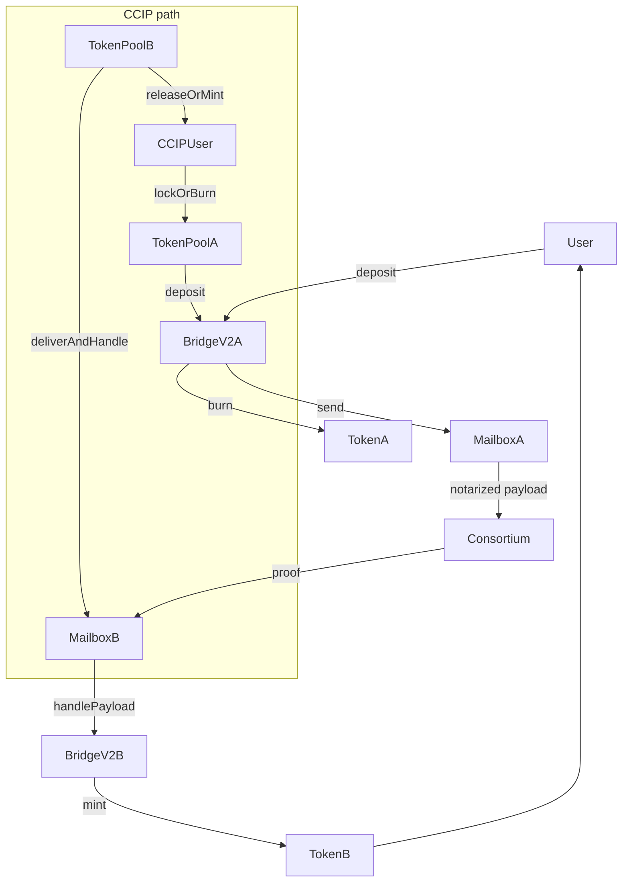

# Lombard EVM bridge contracts

## Overview

`BridgeV2` is the supported cross-chain bridge. It burns tokens on the source chain, relays a notarized message through **GMP** (`Mailbox`), and mints on the destination chain.

`Bridge.sol` and its CCIP adapters (`CLAdapter`, `TokenPool`) are **deprecated and unsupported**. They implemented a 2-factor model (adapter + consortium notarization) that `BridgeV2` replaces.

LayerZero OFT adapters under `oft/` are a separate integration path and do not use `BridgeV2`.

## Architecture

## BridgeV2 flow

### Deposit (source chain)

1. Caller must be **whitelisted** (`setSenderConfig`). Typical senders: CCIP `TokenPool`, direct integrations.
2. Destination path must exist (`setDestinationBridge`) and token mapping must be configured (`addDestinationToken`).
3. `deposit` pulls tokens from `msg.sender`, burns them, encodes a bridge message, and calls `Mailbox.send`.
4. Caller pays a GMP relay fee (`getFee`). Fee is computed from mailbox pricing with an optional per-sender discount.

### Withdraw (destination chain)

1. Relayer delivers a consortium-notarized payload to `Mailbox.deliverAndHandle`.
2. `Mailbox` calls `BridgeV2.handlePayload` (only mailbox; `IHandler`).
3. Bridge validates: payload not spent, inbound path enabled, `msgSender` matches registered peer bridge on source chain, token allowed for that path.
4. **Rate limit** checked per `(sourceChain, token)` (`setTokenRateLimits`).
5. Token minted to recipient. Optional message bytes (v2 payload) returned to mailbox caller.

### Message format

Fixed 129-byte header: `version | destinationToken | sender | recipient | amount`, plus optional trailing bytes (v2 only).

| Field               | Notes                                                                            |
| ------------------- | -------------------------------------------------------------------------------- |
| `version`           | 1 = fixed length; 2 = optional message appended                                  |
| `destinationToken`  | bytes32 token on destination chain                                               |
| `sender`            | original depositor (bytes32)                                                     |
| `recipient`         | mint recipient (bytes32)                                                         |
| `destinationCaller` | set on GMP envelope; restricts who can trigger `deliverAndHandle` on destination |

## Security controls

| Control                 | Scope                                                                      |
| ----------------------- | -------------------------------------------------------------------------- |
| Owner config            | Peer bridges, token paths, sender whitelist, rate limits                   |
| Sender whitelist        | Only approved contracts/EOAs can call `deposit`                            |
| Peer bridge binding     | Inbound `msgSender` must match `bridgeContract[sourceChain]`               |
| Token path allowlist    | Bidirectional mapping per `(chain, token)`                                 |
| Payload replay          | `payloadSpent` on bridge; `deliveredPayload` / `handledPayload` on mailbox |
| Withdraw rate limits    | Per `(sourceChain, localToken)` sliding window                             |
| Consortium notarization | Mailbox verifies validator signatures before handler execution             |
| `destinationCaller`     | Optional restriction on who executes inbound GMP message                   |

## CCIP integration (`providers/`)

`LombardTokenPoolV2` — CCIP 1.6 TokenPool wired to `BridgeV2`:

- **Outbound** (`lockOrBurn`): CCIP burns pool tokens, calls `bridge.deposit` with `destinationCaller` set to the remote TokenPool. Returns GMP `payloadHash` as `destPoolData`.
- **Inbound** (`releaseOrMint`): Decodes `(rawPayload, proof)` from `offchainTokenData`, calls `Mailbox.deliverAndHandle`, asserts returned hash matches `sourcePoolData`.

`BridgeTokenPool` — extends `LombardTokenPoolV2` for wrapped bridge tokens (e.g. Avalanche BTC.b) that route through a `BridgeTokenAdapter` instead of burning the underlying directly.

## LayerZero OFT (`oft/`)

Independent from `BridgeV2`. Uses LayerZero endpoint for messaging.

| Contract                         | Mode                                                        |
| -------------------------------- | ----------------------------------------------------------- |
| `EfficientRateLimitedOFTAdapter` | Abstract OFT adapter with bidirectional rate limits         |
| `LBTCOFTAdapter`                 | Lock/unlock; `empty()` burns locked LBTC after peer removal |
| `LBTCBurnMintOFTAdapter`         | Burn on send, mint on receive                               |

## Deprecated (`Bridge.sol`, `adapters/`)

`Bridge.sol` used adapter-based deposits with optional consortium notarization and a separate withdraw path. Retained in tree for reference only — do not deploy or extend.
